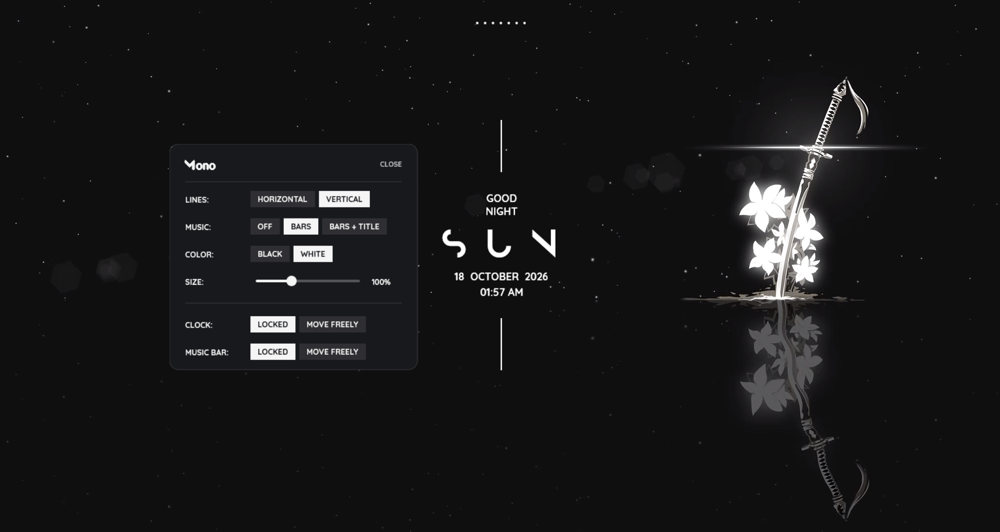

# Mono

A minimalist [Rainmeter](https://www.rainmeter.net/) clock with an optional music bar. A greeting, a big day name, the date and time, two thin lines. Black or white, nothing else on screen.

The Settings panel, with the same clock behind it:

## Features

- Greeting (morning / afternoon / evening / night), big day name, date and time
- **Two layouts**: vertical lines above and below, or horizontal lines on either side of the day
- **Music bar**: a 7-band audio visualizer that rests as dots when silent, with an optional **track title** underneath
- **Black / White** colour switch
- **Size slider** for the clock (50% to 200%)
- **Move freely / Locked**, separately for the clock and the music bar
- One Settings panel for all of it. Your choices are saved and survive restarts

## Requirements

- Windows 10 (1809 or newer) or Windows 11
- Rainmeter 4.5 (built and tested on 4.5.28, Windows 11)

## Install

1. Install [Rainmeter](https://www.rainmeter.net/).
2. Download this repository (**Code, Download ZIP**) and unzip it.
3. Copy the **`Mono`** folder into your Rainmeter skins folder, normally `Documents\Rainmeter\Skins\`. (In Rainmeter: Manage, then **Open Skins folder**.)
4. In Rainmeter, open **Manage**, click **Refresh all**, expand **Mono** and load three skins: `Clock\Clock.ini`, `Music\Music.ini` and `Settings\Settings.ini`. Load only the clock if you don't want the music bar.
5. On first load the skins sit in the top-left corner and are **unlocked**. Drag each one (an outlined box shows what you are grabbing) to where you want it. Then open Settings and choose **Locked** for each.

## Using the Settings panel

Open it from `Settings\Settings.ini`, or right-click the clock or music bar and choose **Mono settings**.

| Setting | Options | What it does |
| --- | --- | --- |
| **Lines** | Horizontal, Vertical | Swaps the two thin lines between side-by-side and above/below |
| **Music** | Off, Bars, Bars + Title | Off unloads the music bar. Bars shows the visualizer. Bars + Title adds the current track |
| **Color** | Black, White | Colour of all text, lines and bars |
| **Size** | 50% to 200% | Scales the whole clock (not the music bar). Click the track or press and drag |
| **Clock** | Locked, Move freely | Move freely shows a drag box so you can reposition it. Locked pins it in place |
| **Music bar** | Locked, Move freely | Same, for the music bar |

Settings are written to `Mono\@Resources\Variables.inc`, so you can also edit that file by hand and refresh the skins.

## Track titles: how it works

The title comes from Windows' own media controls (the same session behind the volume flyout), so it works with browsers and apps alike. It was tested with Brave. Any other app that appears in the Windows media controls should work the same way, but I have not tried them. It shows the current track whether it is playing or paused.

Under the hood, Rainmeter's RunCommand plugin runs `Mono\@Resources\smtc.ps1` about every 3.5 seconds, only while **Bars + Title** is selected. The script is short and you can read it yourself. It only reads the title and artist of the current media session. It does not use the network and writes no files. It is started with `-ExecutionPolicy Bypass` for that one file only, which is why it runs without changing your system policy.

## Troubleshooting

- **No title under the bars.** Pick **Bars + Title** in Settings, and make sure something shows up in Windows' media controls. A paused track still counts, a closed tab does not.
- **Text is hard to read on my wallpaper.** Mono has no background plate on purpose. Use **Black** over light wallpapers and **White** over dark ones.
- **I can't see the skins.** Rainmeter skins sit at desktop level, so any maximized window covers them. Use Show desktop.
- **I edited a file and nothing changed.** Right-click the skin, then **Refresh skin**.
- **Everything is stuck in the top-left corner.** Open Settings, choose **Move freely** for the clock and the music bar, and drag them apart.

## Customizing

Open the `.ini` files in any text editor. The useful knobs:

- `Clock\Clock.ini`: `Gap` and `Len` set where the horizontal lines start and how long they are. `FontSize` values set the text size at 100%.
- `Music\Music.ini`: `H` is the height of the tallest bar. `Sensitivity` and `FFTDecay` tune how lively the bars are.
- `@Resources\smtc.ps1`: change the output format here, for example title only.

## Known limitations

- Windows only, and the track title needs Windows 10 1809+.
- The size slider is built from click zones and a hover hand-off, because Rainmeter has no drag event. It moves in 10% steps.
- The title uses a short-lived PowerShell process every few seconds. Choose **Bars** or **Off** if you don't want that.
- Tested on one machine (Windows 11, Rainmeter 4.5.28, 125% display scaling). Reports from other setups are welcome.

## Inspiration

Mono is inspired by **Mond** by **Connect-R**, a Rainmeter suite I used as the reference for this look. Credit where it is due. What I took from Mond:

- The overall composition: a small greeting above a big day name, the date and time under it, framed by two thin lines
- The font pairing: a wide display face for the day name and Quicksand for the small text
- The wide letter spacing on the day name, and the idea of one scale value that resizes the whole clock

What is mine: the clock, music bar and settings are written from scratch, and so are the horizontal/vertical line layouts, the black/white switch, the size slider, the move/lock controls and the track-title script. I did not copy Mond's files, and I left out its weather, player, recycle bin, images and language files. If you like this style, go look at Mond.

## Credits and licenses

- **Mond** by Connect-R, for the inspiration above.
- **Quicksand** is licensed under the SIL Open Font License 1.1, included as `Mono\@Resources\Fonts\OFL.txt`.
- The skin code is MIT licensed, copyright (c) 2026 MR_UNKNOWN8014, see `LICENSE`. The fonts keep their own licenses.
